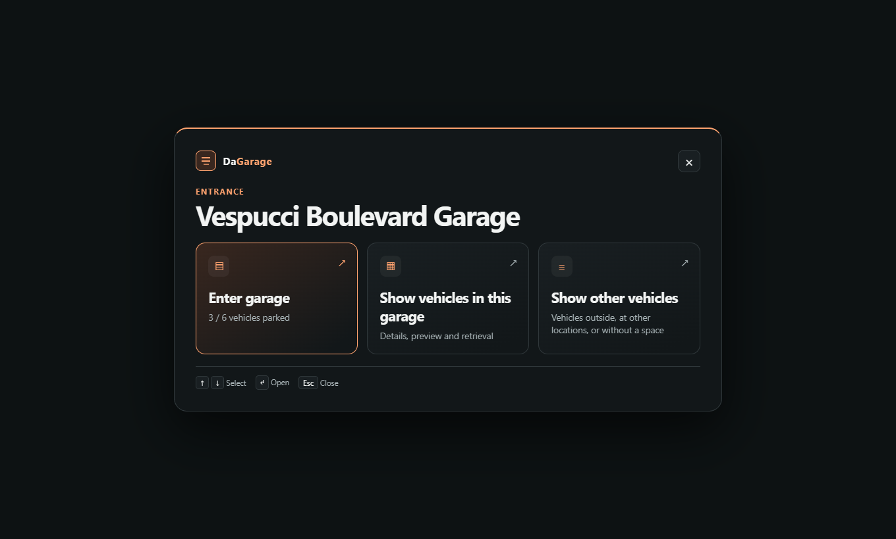
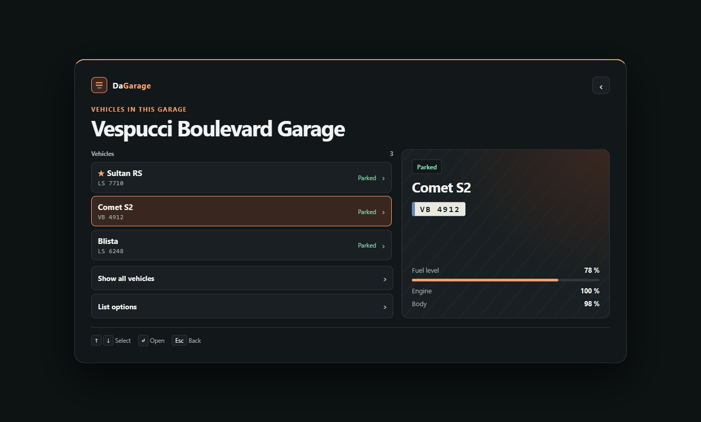
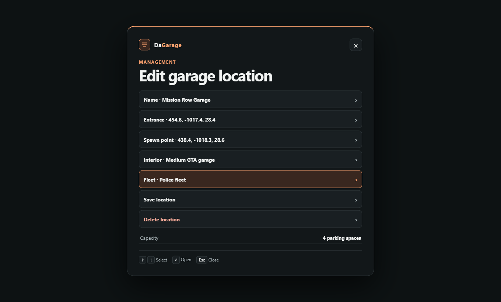

# DaGarage

DaGarage is a FiveM garage for private ESX vehicles and Society fleets. It supports walk-in interiors, persistent parking spaces, location-based retrieval, and optional myFuel and AdvancedParking integration.

## Screenshots

### Garage entrance



### Vehicle list



### Admin editor



Screenshots show the DaGarage NUI rendered with example data.

## Installation

DaGarage requires OneSync, `oxmysql`, `es_extended`, `DaTuning`, and the standard ESX `owned_vehicles` table. DaGarage creates its missing database columns and tables at startup. If the database account cannot run `ALTER` or `CREATE`, have a database administrator import the missing migrations in order:

1. [dagarage.sql](dagarage.sql)
2. [dagarage_slots.sql](dagarage_slots.sql)
3. [dagarage_garages.sql](dagarage_garages.sql)

If you use myFuel, install its `myfuel_vehicle_tanks.sql` migration. If you use AdvancedParking, its resource folder must be named `AdvancedParking`.

```cfg
ensure DaTuning
# ensure myFuel
# ensure AdvancedParking
ensure DaGarage
```

If `ensure [esx_addons]` starts `esx_garage`, add `stop esx_garage` after that group and before starting DaGarage.

## Using a garage

- Press **E** at an outside garage marker on foot. At garages with an interior, you can enter, browse vehicles parked here, or browse your other vehicles. At a garage without an interior, **E** opens the full list.
- Press **E** as the driver at the marker to park. The exit checks its configured spawn point for vehicles before retrieval.
- Press **G** at a garage with an interior to enter directly. Inside, look at a nearby vehicle to see its details over the car, or press **H** for the full details. With myFuel running, the details include the required fuel type.
- Use **H → Change parking space** by a vehicle, or press **E** at the orange **Manage parking spaces** marker. A space can stay reserved while its vehicle is outside and can be released if another parked vehicle needs it. Moving the vehicle to a different garage frees its old space. In interiors with multiple pages, press **G** to switch between occupied pages.
- Move briefly forward or in reverse from the driver's seat to take the vehicle out. Retrieval starts about a third of a second after it begins rolling. On foot, press **E** at the green exit or use `/garageverlassen`.

You can use the UI with the mouse or with the arrow keys, **Enter**, and **Esc**. **List options** provides search and location filters. Favorites persist per ESX character and appear first. Vehicle details include the 3D preview and, where a position is known, a waypoint to a vehicle outside.

## Configuration

Set `Config.Locale = 'en'` for English or `'de'` for German in [config.lua](config.lua). Add translations in [locale.lua](locale.lua). Interior and fleet profile labels can be translated. Location names and labels supplied by other resources come from their original source. Set `Config.UIColors` with `#RRGGBB` values to change the UI colors.

- `Config.GarageMode = 'shared'` allows retrieval from any garage that serves the same owner or fleet.
- `Config.GarageMode = 'local'` associates a parked vehicle with its last garage.
- In local mode, `Config.RemoteRetrievalFee = false` disables retrieval at another garage. A whole number such as `500` sets the cash fee. Use `0` for free retrieval. The fee is charged after a successful spawn and also applies when recovering a missing vehicle with a known parking location.

Vehicles without a saved location can initially be retrieved anywhere. DaGarage records a vehicle's location the next time it is parked, including in shared mode. Keep keys in `Config.Garages` stable so saved locations continue to work.

### Interiors and capacity

Capacity is the number of positions per page multiplied by the number of pages. The limit counts parked vehicles per character or Society. Garages without an interior have unlimited capacity. If you switch to a smaller profile, any excess vehicles can still be retrieved from the list at the entrance.

| Profile | GTA V interior | Total capacity |
| --- | --- | ---: |
| `gta_klein` | Standard two-car garage | 2 |
| `gta_mittel` | Standard six-car garage with four configured spaces | 4 |
| `gta` | Standard ten-car garage with six configured spaces | 6 |
| `gta_gross` | Standard ten-car garage with two pages of six spaces | 12 |

To use a custom MLO, add a profile under `Config.Interiors` with `entry` and `slots` as `vector4` values and `door` as a `vector3`. Optional fields include `slotStation` for a parking-space management point, `pages` for the number of pages, and `resource` for the name of an installed MLO resource. Assign the profile key to the garage's `interior` setting. `Config.InteriorBucketBase` sets the start of the routing bucket range used for private instances.

## Locations and administration

The two default garages are **Vespucci Boulevard** at `(-285.2, -886.5, 31.0)` and **San Andreas Avenue** at `(216.4, -786.6, 30.8)`. Map blips are labeled **Garage**. Edit locations from `config.lua` in that file.

Run `/dagarageadmin` in game to manage database-backed locations. DaGarage checks for the ESX `admin` or `superadmin` group on the server.

1. Choose **Create location** and enter a name.
2. Choose **Entrance**. Use your current position, walk to the spot and press **E**, or enter `X Y Z`.
3. Choose **Spawn point**. Your heading is captured when placing it in game. When entering coordinates, include the heading as the fourth value, for example `-309.3 -897.0 31.0 351.9`.
4. Choose an interior and, if needed, a fleet profile. The editor shows the interior capacity.
5. Choose **Save location**. Blips and interaction points update for all players.

The same menu edits or deletes database-backed locations. Move assigned vehicles to another garage before deleting a location or switching its fleet. Database-backed location keys start with `dagarage_db_`.

### Society garages

Select **Police fleet** in the admin editor or add more profiles under `Config.AdminSocieties`. For a config-managed location, use an inline profile:

```lua
society = {
    job = 'police',
    minGrade = 0,
    manageGrade = 3,
    models = { 'police', 'police2' }
}
```

`minGrade` controls fleet access. `manageGrade` controls parking-space changes and access to **Add vehicle to fleet**. Adding an approved model creates a permanent fleet vehicle with a unique plate at no cost. Omit `manageGrade` to disable that action.

Fleet vehicles use `owner = 'society_<job>'` and `job = '<job>'` in `owned_vehicles`. Existing vehicles with the correct owner and a matching or empty job field are included. Each authorized member sees that location's parked fleet vehicles in a private instance. Private garages remain scoped to their owner.

## Vehicle persistence

- **DaTuning:** DaGarage saves and restores the current ESX vehicle properties through `owned_vehicles.vehicle`, including mods, paint, wheels, extras, lights, liveries, and damage.
- **Fuel provider:** Edit `Config.GetFuel(vehicle, theme)` and `Config.SetFuel(vehicle, level)` in [config.lua](config.lua). Both hooks run on the client. When parking, DaGarage calls the getter without a theme and saves its first return value, a fuel level from 0 to 100. The setter receives that level when retrieving. Set both hooks to `nil` to use native fuel levels.
- **myFuel:** The default hooks call the myFuel exports when the resource is running. Set `Config.UseMyFuelTankData = false` to disable myFuel-specific tank initialization, fuel type display, and misfueling data when using another provider.
- **AdvancedParking:** When running, it manages persistence for vehicles outside. DaGarage removes stored vehicles from the world and AdvancedParking's records when parking. Retrieval checks both live vehicles and known AdvancedParking positions. [AdvancedParking server exports](https://docs.kiminaze.de/scripts/advancedparking/exports-server/)

With `Config.RecoverMissingVehicles`, an ESX vehicle marked `stored = 0` can be recovered when no live vehicle or stored AdvancedParking position is found. Impounded vehicles (`stored = 2`) cannot be retrieved through the garage.

## In-game checks

1. Tune a vehicle with DaTuning, park it, and retrieve it. Check its paint, mods, and fuel level.
2. Repeat with a vehicle that has been misfueled and check that myFuel restores the tank state.
3. Park and retrieve a vehicle with AdvancedParking off. Check the waypoint to a vehicle outside. With AdvancedParking enabled, also verify restoration of vehicles left outside and their removal from persistence when parked.

## 💬 Support

Need help, found a bug, or have a question?

Join our Discord server for support!

[](https://discord.gg/Cxfe2y8TJ)
